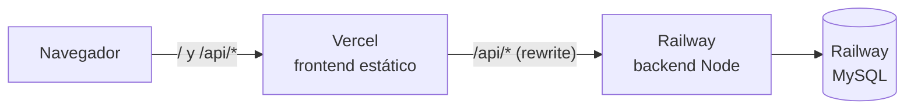

# Sistema de Gestión Logística y de Flota

Plataforma integral para la gestión y optimización de las operaciones logísticas de una empresa de transporte: administra la flota vehicular, el personal (choferes), la ejecución de viajes y el mantenimiento, con alertas automáticas, auditoría, reportes y un panel de indicadores.

Trabajo práctico de Desarrollo de Software (DSW). Full-stack con backend REST y frontend SPA.

---

## Qué hace el sistema

- **Gestión de flota:** alta/baja de vehículos, estado en tiempo real (disponible, en viaje, en taller, inactivo), historial de kilometraje y mantenimiento.
- **Gestión de choferes:** disponibilidad, documentación obligatoria (DNI, licencia, ART, psicofísico), y control de vencimientos.
- **Viajes:** planificación, asignación de chofer con selección automática de vehículo, seguimiento de estado (pendiente → en curso → finalizado) y registro de kilometraje.
- **Mantenimiento:** preventivo y correctivo, con tipos configurables, máquina de estados y comprobantes adjuntos.
- **Alertas automáticas:** vencimientos de licencia/documentación/seguro, km de mantenimiento superado, vehículos inactivos, con reconciliación (auto-resolución).
- **Auditoría:** registro inmutable de todas las acciones, con detalle de antes/después.
- **Reportes y dashboard:** indicadores clave (utilización de flota, viajes, mantenimientos, alertas) y reportes por período.
- **Roles:** Administrador (acceso total), Operador (operación diaria) y Chofer (app mobile con su viaje, historial y documentación).

---

## Tecnologías

**Backend** — Node.js + TypeScript · Express 4 · Prisma 7 (ORM) · MySQL 8 · Zod (validación) · JWT + bcrypt (auth) · Helmet · Pino (logging) · Multer (archivos) · Nodemailer (email) · Vitest (tests).

**Frontend** — React 18 + TypeScript · Vite · Material UI (MUI) · React Router · Zustand (estado) · Axios · Recharts (gráficos) · Vitest (tests).

---

## Estructura del repositorio

```
.
├── backend/          API REST (Node + Express + Prisma). 13 módulos, 60 endpoints.
│   ├── src/
│   │   ├── modules/  un módulo por entidad (routes / controller / service / repository / schemas)
│   │   ├── middlewares/  auth, validación, manejo de errores, rate limiting, uploads
│   │   ├── shared/   utilidades, errores, tipos comunes
│   │   └── config/   validación de entorno (fail-fast)
│   └── prisma/       schema, migraciones y seed de datos de demostración
├── frontend/         SPA React (Vite + MUI). Todas las pantallas por rol. Una carpeta por componente, código en inglés.
│   └── src/
│       ├── pages/<módulo>/<Componente>/  pantallas y diálogos (trips, drivers, vehicles, alerts, ...)
│       ├── components/<Componente>/      reutilizables (DataTable, SearchField, SortControl, ...)
│       ├── layouts/<Componente>/         layouts por rol (sidebar admin/operador, mobile chofer)
│       ├── api/      clientes HTTP tipados por recurso
│       ├── hooks/    hooks compartidos (sesión, avisos, listas paginadas)
│       ├── theme/    sistema de diseño (tokens de color, tema claro/oscuro)
│       └── auth/     guards de rutas
│       Cada carpeta de componente: X.tsx · X.types.ts · X.const.ts · X.data.ts · X.helpers.ts · X.styles.ts · tests
│       (solo los que hacen falta). Imports con alias `@/` = `src/`. Detalle: docs/manual-tecnico/21b-frontend-estructura.md
├── docs/             documentación del proyecto (ver abajo)
└── GUIA-PRUEBAS-E2E.md   guía de pruebas manuales end-to-end
```

---

## Documentación

Toda la documentación de diseño y desarrollo está en `docs/`: (índice completo en [docs/README.md](docs/README.md))

- **`analisis-funcional-gestion-logistica.md`** — análisis funcional completo: requisitos, reglas de negocio (RN), casos de uso. Es la fuente de verdad del proyecto.
- **`etapa-1-arquitectura.md`** — decisiones de arquitectura y convenciones.
- **`etapa-2-der-definitivo.md`** y **`etapa-2-modelo-relacional.md`** — diagrama entidad-relación y modelo relacional.
- **`schema.sql`** — DDL de referencia de la base de datos.
- **`DEVLOG.md`** — bitácora de desarrollo: historial de decisiones técnicas, etapa por etapa.
- **`PLAN-DE-PRUEBAS.md`** — plan de pruebas (automatizadas + manuales).
- **API:** documentación OpenAPI navegable en `/api/v1/docs` (Swagger UI), generada desde `backend/src/docs/openapi.ts`.

---

## Cómo levantar el proyecto

**Requisitos:** Node.js 20.19+ (o 22.12+), MySQL 8, y npm. Es la versión mínima que exige Prisma 7; está declarada en `backend/package.json` (`engines`).

### 1. Backend

```bash
cd backend
npm install
cp .env.example .env          # completar DATABASE_URL, JWT secrets, PASSWORD_ENCRYPTION_KEY
npx prisma migrate dev --name init
npx prisma db seed
npm run dev                   # http://localhost:3000
```

Variables de entorno necesarias (ver `backend/.env.example`): conexión a MySQL, secretos JWT, clave de cifrado de contraseñas (AES-256-GCM), y opcionalmente configuración SMTP para el envío real de credenciales.

### 2. Frontend

```bash
cd frontend
npm install
cp .env.example .env          # opcional: VITE_GOOGLE_MAPS_API_KEY (la API se alcanza por el proxy de Vite)
npm run dev                   # http://localhost:5173
```

### Backend en modo producción

`npm run dev` ejecuta TypeScript directamente. Para producción (o para probar localmente lo mismo que corre en el deploy), el backend se compila a JavaScript y se ejecuta con Node:

```bash
cd backend
npm ci                        # también regenera el cliente de Prisma (postinstall)
npm run build                 # limpia dist/ y compila src/ → dist/ (sin los tests)
npm run prisma:deploy         # aplica las migraciones pendientes; nunca borra datos
NODE_ENV=production npm start # node dist/server.js
```

En producción se usa `prisma migrate deploy`, no `migrate dev`: este último puede ofrecer resetear la base si detecta diferencias. Los archivos subidos (documentos y comprobantes) se guardan en la base de datos, así que el servidor no necesita disco persistente.

### Deploy (Vercel + Railway)



El navegador habla solo con Vercel. Vercel sirve el frontend y reenvía `/api/*` al backend en Railway (`frontend/vercel.json`). En desarrollo, el proxy de Vite hace lo mismo con `localhost:3000` (`frontend/vite.config.ts`). Así la cookie de sesión es del mismo sitio que la app. Si el frontend llamara directo a `up.railway.app`, sería una cookie de terceros: Safari la bloquea y la sesión se perdería en cada recarga.

**1. Base de datos.** En el proyecto de Railway: *+ New → Database → MySQL*.

**2. Backend.** *+ New → GitHub Repo* con este repositorio. En el servicio:

- *Settings → Source → Root Directory*: `backend`. Sin esto Railway arma desde la raíz del repo, donde no hay `package.json`, y falla con `npm: not found`.
- El resto lo toma de `backend/railway.json`:
  - build con `npm ci --include=dev && npm run build`;
  - migraciones antes de cada deploy (`npm run prisma:deploy`, que nunca borra datos);
  - arranque con `npm start`;
  - health check en `/health`.
- *Settings → Networking → Generate Domain*: es la URL pública del backend.
- *Variables*:

  | Variable | Valor |
  |:--|:--|
  | `NODE_ENV` | `production` |
  | `DATABASE_URL` | `${{MySQL.MYSQL_URL}}?allowPublicKeyRetrieval=true` (referencia a la base del paso 1) |
  | `JWT_ACCESS_SECRET` y `JWT_REFRESH_SECRET` | dos valores distintos de `node -e "console.log(require('crypto').randomBytes(48).toString('hex'))"` |
  | `PASSWORD_ENCRYPTION_KEY` | `node -e "console.log(require('crypto').randomBytes(32).toString('hex'))"` |
  | `CORS_ORIGIN` y `APP_URL` | la URL de Vercel (paso 3). Mientras no exista, `http://localhost:5173` |
  | `TRUST_PROXY` | `2` (los dos saltos del proxy de Railway) |
  | `CLIENT_IP_HEADER` | `x-vercel-forwarded-for` (ver paso 5) |

  `PORT` lo pone Railway. Las variables de las alertas tienen valores por defecto (ver `backend/.env.example`).

**3. Frontend (Vercel).** *Add New → Project*, con *Root Directory* `frontend`. El resto lo detecta solo (Vite). No necesita variables de entorno. `frontend/vercel.json` ya apunta al backend en `gestion-logistica-api-production.up.railway.app`; si el dominio de Railway cambia, hay que corregirlo ahí. Después de crearlo, volver a Railway y poner la URL de Vercel en `CORS_ORIGIN` y `APP_URL`.

**4. Datos de demostración (una sola vez).** Desde tu compu, contra la base de Railway:

- Activar el acceso público temporal: *MySQL → Settings → Networking → Add Public Access*. Eso crea `MYSQL_PUBLIC_URL` (*MySQL → Variables*, copiar con el ícono, no con *Edit*).
- Usar **la misma** `PASSWORD_ENCRYPTION_KEY` que tiene el backend en Railway: el seed cifra con ella las contraseñas de los choferes.

```bash
cd backend
DATABASE_URL='<MYSQL_PUBLIC_URL>?allowPublicKeyRetrieval=true' PASSWORD_ENCRYPTION_KEY='<la del backend>' npm run prisma:seed
```

Tarda uno o dos minutos. **Después, cambiar las contraseñas de la demo:** las del seed están en este README, que es público, y con ellas cualquiera entraría como administrador. Con las mismas variables:

```bash
DATABASE_URL='<MYSQL_PUBLIC_URL>?allowPublicKeyRetrieval=true' PASSWORD_ENCRYPTION_KEY='<la del backend>' npx tsx prisma/rotate-demo-passwords.ts --yes
```

Genera una contraseña aleatoria para cada cuenta de la demo, cierra sus sesiones y las muestra una sola vez. Se entregan por un canal privado, no en el repositorio. Si se vuelve a correr el seed, las contraseñas vuelven a ser las del README, así que hay que repetir este paso.

Al terminar, quitar el acceso público (tacho en *Networking*): el backend usa la red interna. Volver a correrlo reinicia toda la demo (viajes, alertas y auditoría).

**5. IP del usuario (límite de intentos de login).** El rewrite de Vercel no agrega la IP del usuario a `X-Forwarded-For`: ahí manda la suya, y la del usuario va en `x-vercel-forwarded-for`. Por eso `CLIENT_IP_HEADER=x-vercel-forwarded-for`. Para verificarlo, abrir un pedido en *Deploy Logs*: el atributo `clientIp` tiene que coincidir con tu IP pública (la que muestra `https://api.ipify.org`). Si mostrara la de Vercel, todos los usuarios compartirían el límite de 10 intentos. Como ese header se puede falsificar llamando al backend directo, hay además un tope de 100 intentos por `req.ip` (resuelto con `TRUST_PROXY=2`).

*`render.yaml` queda como alternativa para Render, con la misma configuración.*

### Credenciales del seed

| Rol | Email | Contraseña |
|-----|-------|-----------|
| Administrador | `admin@empresa.com` | `Admin1234!` |
| Operador | `operador@empresa.com` | `Operator1234!` |
| Chofer | `chofer@empresa.com` | `Driver1234!` |

El seed carga una empresa con ~200 días de operación (más de 400 viajes, mantenimientos, alertas resueltas y auditoría). El resto de los usuarios de demostración —otra operadora y seis choferes más, cada uno en un estado distinto— está en `GUIA-PRUEBAS-E2E.md`.

---

## Pruebas

**Automatizadas (sin base de datos):**

```bash
cd backend  && npm test      # 171 tests: crypto, fechas UTC, schemas, filtros/orden/búsqueda, concurrencia de servicios, archivos en la base, job de alertas diario + horario, alerta de viaje sin asignar, documentación completa para asignar, seed
cd frontend && npm test      # 169 tests: todas las pantallas por rol en modo claro y oscuro (smoke), contraste de la paleta (WCAG AA), buscador, tarjetas de alerta, mensajes de error, fechas, selector de fecha, rutas por rol, auditoría
```

**Con base de datos (integración y E2E):** usan una base MySQL aparte, `TEST_DATABASE_URL` en `backend/.env` (ver `backend/.env.example`). Su nombre tiene que terminar en `_test`, porque los tests la vacían y la vuelven a sembrar. Se crea y se migra sola.

```bash
cd backend  && npm run test:integration   # 23 tests: la API real (supertest) contra MySQL: flujo de viajes, reglas, permisos, alertas, sesión y carreras de concurrencia
cd frontend && npx playwright install chromium   # una sola vez
cd frontend && npm run test:e2e           # 12 tests: navegador real (Playwright) contra todo el sistema: login por rol, viaje completo, pantallas de administración
```

**Manuales (end-to-end):** ver `GUIA-PRUEBAS-E2E.md` — guion paso a paso por rol contra la app corriendo.

**Documentación de la API (Swagger):** con el backend corriendo, `http://localhost:3000/api/v1/docs` (y el JSON en `/api/v1/openapi.json`). Para probar los endpoints protegidos, hacé login en `POST /auth/login` y pegá el `accessToken` en **Authorize**.

---

## Notas de seguridad

- Los archivos `.env` (con secretos) están excluidos del repositorio vía `.gitignore`. Usar los `.env.example` como plantilla.
- Contraseñas de usuarios con bcrypt; contraseñas de choferes además cifradas con AES-256-GCM (requisito de negocio: consultables por el administrador).
- Autenticación con access token JWT de vida corta + refresh token opaco (hash SHA-256) en cookie httpOnly, con rotación.
